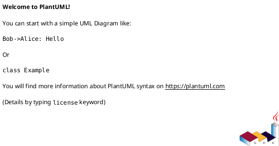

# Step 4: Building Blocks — Logical View

## MANDATORY EXECUTION RULES:

- 📖 Read complete step file before acting
- 🛑 Do NOT generate content without user input
- ✅ Communicate in {communication_language}, write output in {document_output_language}

## OUTPUT:

`{architecture_output}/1-architecture/04-logical-view.md`

## YOUR TASK:

Collaboratively define the system's building blocks — components, layers, boundaries. Arc42 §5.

## DISCOVERY QUESTIONS:

1. "What are the major components/modules of the system? Think C4 containers."
2. "For each component — what is its single responsibility?"
3. "How do components communicate? (direct calls, queues, events, shared DB)"
4. "What are the hard boundaries? What should NEVER know about what?"
5. "What is the core domain model? Key entities and relationships?"

## DIAGRAM:

Propose a C4 Level 2 (Container) diagram. Can be PlantUML or Mermaid:

Save diagram to `{architecture_output}/diagrams/` if user approves.

## GENERATION:

Generate `04-logical-view.md` using template. Show for review.

[A] Approve and continue
[E] Edit

## NEXT STEP:

After approval, update frontmatter, then load `./step-05-runtime.md`.
